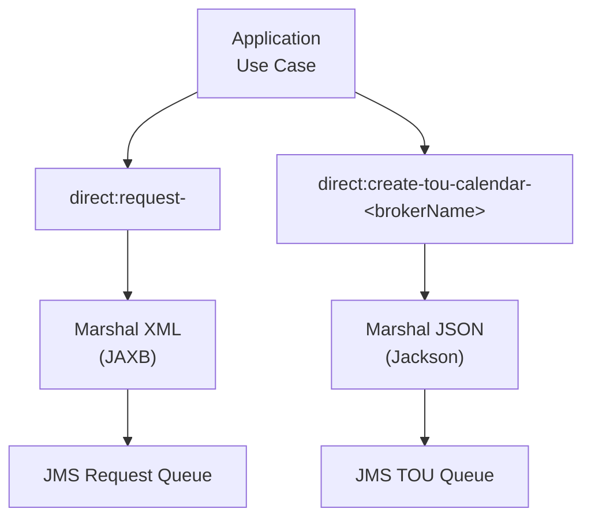
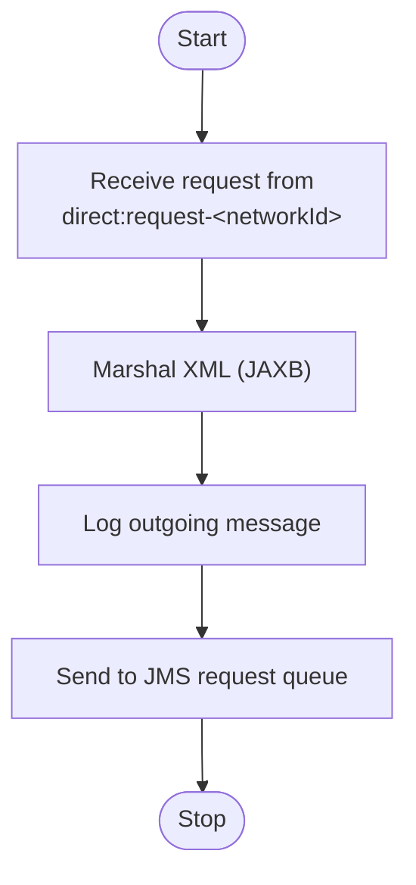
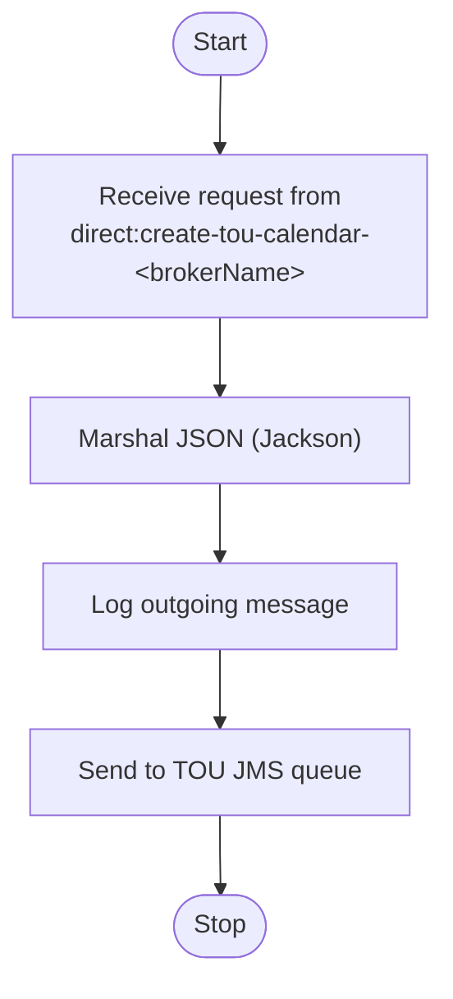
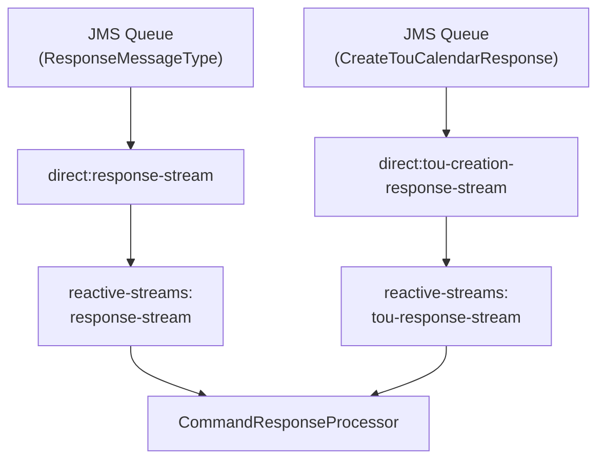
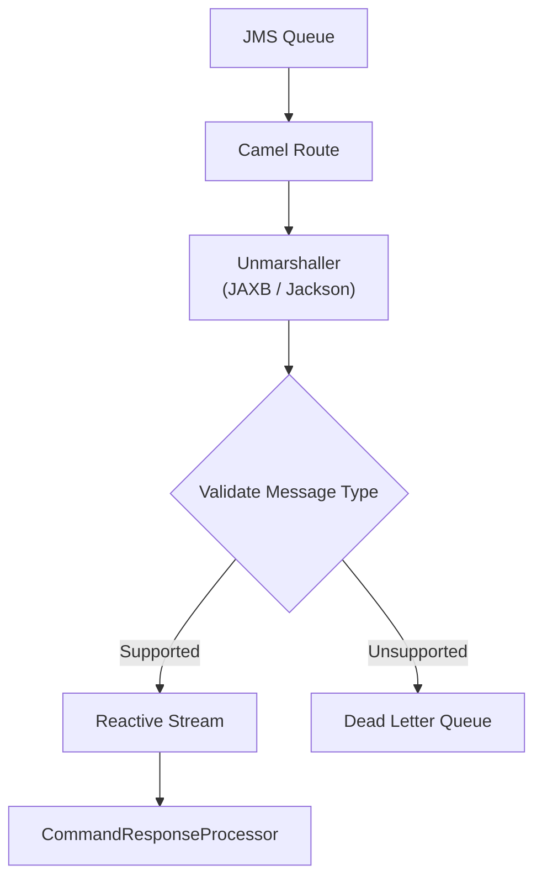
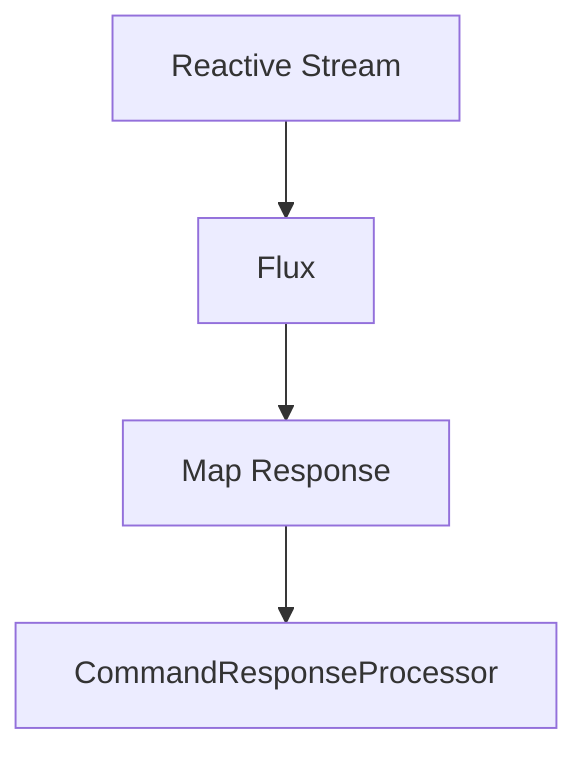
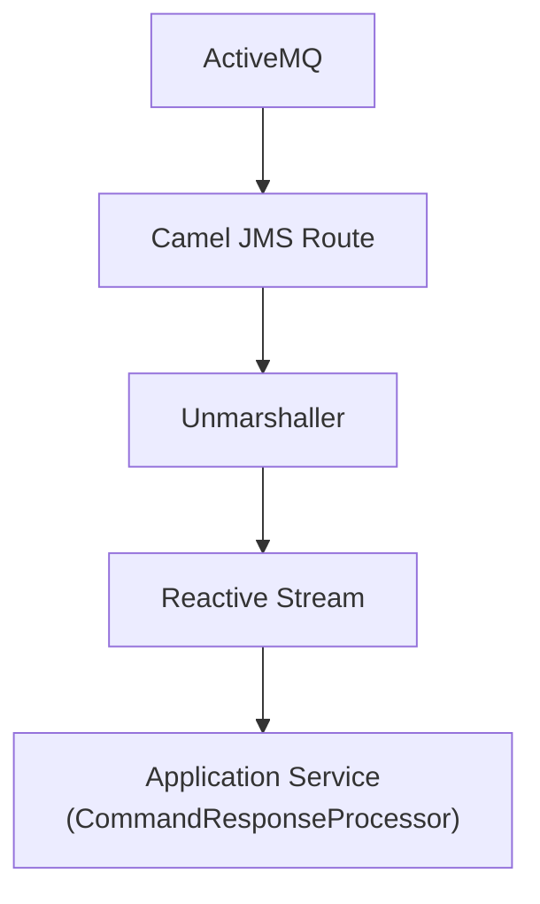

# IEC connector camel routes
- [Outbound routes](#outbound-routes)
  - [Responsibilities](#responsibilities)
  - [Camel routes](#camel-routes)
  - [Route overview](#route-overview)
  - [Dynamic route generation](#dynamic-route-generation)
  - [Request processing](#request-processing)
  - [Layer interaction](#layer-interaction)
  - [Design observations](#design-observations)
- [Inbound routes](#inbound-routes)
  - [Responsibilities](#responsibilities-1)
  - [Camel routes](#camel-routes-1)
  - [Route overview](#route-overview)
  - [Supported message types](#supported-message-types)
  - [Processing pipeline](#processing-pipeline)
  - [Dynamic route creation](#dynamic-route-creation)
  - [Reactive processing](#reactive-processing)
  - [Processing pipeline](#processing-pipeline)
  - [Runtime flow](#runtime-flow)
  - [Error handling](#error-handling)
  - [Layer interaction](#layer-interaction-1)
  - [Design observations](#design-observations-1)
- [Symmetry between the inbound and outbound route builders](#symmetry-between-the-inbound-and-outbound-route-builders)
## Outbound routes
- `C:\Git\gfc-app\iec61968-connector\src\main\java\com\landisgyr\gfc\iec61968_connector\adapters\outbound\jms\OutboundCamelRouteBuilder.java`
- Defines outbound Camel routes for publishing requests to ActiveMQ.
- Dynamically creates routes for each configured broker and hosted network.
- Marshals Java objects into XML or JSON before sending.
- Routes application requests to the appropriate JMS queues.
- Supports both control command requests and TOU calendar creation requests.
### Responsibilities
- Create outbound JMS routes for each configured network.
- Marshal request payloads.
  - XML using `JAXB`
  - JSON using `Jackson`
- Publish messages to the configured ActiveMQ queues.
- Log outbound requests.
- Support multiple brokers and hosted networks through dynamic route generation.
### Camel routes
- The route builder dynamically creates the following routes.

| Route ID | From | To | Purpose |
| --- | --- | --- | --- |
| `request-to:<networkId>:<requestQueue>` | `direct:request-<networkId>` | `jms:<requestQueue>` | Publish IEC61968 XML requests to the network request queue |
| `create-tou-calendar:<brokerName>` | `direct:create-tou-calendar-<brokerName>` | `jms:touXmlUploadRoute` | Publish TOU calendar creation requests |

### Route overview
<details>
  <summary>mermaid</summary>
  

</details>

## Dynamic route generation
- One request route is created for every configured hosted network.
- Queue names are obtained from `ApplicationSetting`.
- Routes are created during application startup.
- Example generated endpoint:
```text
direct:request-<networkId>

Destination queue:
jms-<broker>:queue:<requestQueue>

Generated route identifier:
request-to:<networkId>:<requestQueue>

TOU calendar endpoint:
direct:create-tou-calendar-<brokerName>

Destination queue:
jms-<broker>:queue:touXmlUploadRoute
```

### Request processing
<details>
  <summary>mermaid</summary>
  

</details>

#### TOU calendar requests
<details>
  <summary>mermaid</summary>
  

</details>

### Layer interaction
| Layer | Component | Responsibility |
| --- | --- | --- |
| Adapter | `OutboundCamelRouteBuilder` | Marshal requests and publish to ActiveMQ |
| Infrastructure | ActiveMQ | Deliver messages to downstream IEC61968 systems |
| Domain | Domain models | Carry business data |
### Design observations
- Implements **dynamic route generation** for every configured hosted network.
- Separates transport concerns from application logic.
- Supports multiple brokers without code changes.
- Uses Camel `direct:` endpoints to decouple the application layer from JMS.
- Marshals transport-specific payloads immediately before publication.
- Keeps business services independent of Camel, JMS, XML, and JSON serialization.
```java
// Route 1
// ~75
from(directEndPoint)
  .marshal(jaxbDf)
  .log(...)
  .to(brokerComponent + ":queue:" + requestQueue + "?jmsMessageType=Text")
  .log(...);
```
```java
// Route 2
// ~95
from(createTouCalendarEndpoint)
  .marshal(jsonFormat)
  .to(brokerComponent + ":queue:" + createTouCalendarQueue)
```
## Inbound routes
- `C:\Git\gfc-app\iec61968-connector\src\main\java\com\landisgyr\gfc\iec61968_connector\adapters\inbound\jms\InboundCamelRouteBuilder.java`
- Defines inbound Camel routes for consuming command responses from multiple JMS brokers.
- Dynamically creates routes based on broker and network configuration.
- Converts incoming XML and JSON messages into Java objects.
- Publishes supported messages to Camel Reactive Streams.
- Delegates business processing to the application layer.
- Routes unsupported messages to the Dead Letter Queue (DLQ).
### Responsibilities
- Create JMS consumers for configured brokers.
- Dynamically register routes for each hosted network.
- Unmarshal incoming messages.
  - XML using `JAXB`
  - JSON using `Jackson`
- Validate supported message types.
- Publish messages to Reactive Streams.
- Delegate processing to `CommandResponseProcessor`.
- Handle processing failures without stopping message consumption.
### Camel routes
- The route builder defines the following Camel routes.

| Route ID | From | To | Purpose |
| --- | --- | --- | --- |
| `response-from:<networkId>:<responseQueue>` | `jms:<responseQueue>` | `direct:response-stream` | Consume XML command responses from ActiveMQ |
| `response-from:<brokerName>:responseQueue` | `jms:responseQueue` | `direct:tou-creation-response-stream` | Consume JSON TOU calendar responses |
| `forward-to-response-stream` | `direct:response-stream` | `reactive-streams:response-stream` | Forward XML responses to the Reactive Stream |
| `forward-to-tou-response-stream` | `direct:tou-creation-response-stream` | `reactive-streams:tou-response-stream` | Forward TOU responses to the Reactive Stream |

### Route overview
<details>
  <summary>mermaid</summary>
  

### Supported message types
| Message type | Format | Reactive stream |
| --- | --- | --- |
| `ResponseMessageType` | XML | `response-stream` |
| `CreateTouCalendarResponse` | JSON | `tou-response-stream` |

### Processing pipeline
<details>
  <summary>mermaid</summary>
  

### Dynamic route creation
- Routes are created automatically for every configured broker.
- Each hosted network receives its own response route.
- Queue names are obtained from `ApplicationSetting`.
- Example generated route:
```text
jms-<broker>:queue:<responseQueue>

Route identifier:
response-from:<networkId>:<responseQueue>
```
### Reactive processing
- Camel publishes messages into Reactive Streams.
- `Flux` subscribes to each stream.
- Processing is asynchronous.
- Backpressure buffering prevents message loss.
- Processing errors are logged and ignored to keep consumers active.
### Processing pipeline
<details>
  <summary>mermaid</summary>
  

### Runtime flow
<details>
  <summary>mermaid</summary>
  

</details>

### Error handling
- Unsupported message types are routed to the broker DLQ.
- Processing exceptions are logged.
- Errors are swallowed using `onErrorResume()` to prevent termination of the Reactive Stream.
- Optional Camel `DeadLetterChannel` configuration is present but currently disabled.
### Layer interaction
| Layer | Component | Responsibility |
| --- | --- | --- |
| Adapter | `InboundCamelRouteBuilder` | Consume JMS messages and publish Reactive Streams |
| Adapter | `ControlCommandResponseMapper` | Convert transport models into domain models |
| Application | `CommandResponseProcessor` | Execute business processing |
| Domain | Domain models | Carry business data |
### Design observations
- Uses **dynamic route generation** instead of hardcoded JMS consumers.
- Separates transport handling from business processing.
- Combines Apache Camel with Reactor (`Flux`/`Mono`) for asynchronous processing.
- Supports multiple brokers and hosted networks without additional code changes.
- Keeps the application layer independent of JMS, Camel, XML, and JSON transport concerns.
```java
// Route 1
// ~130
from(brokerComponent + ":queue:" + responseQueue)
  .unmarshal(jaxbDf)
  .choice()
  .when(body().isInstanceOf(ResponseMessageType.class))
  .to("direct:response-stream")
  .otherwise()
  .to(brokerComponent + ":queue:GFC_DLQ");
```
```java
// Route 2
// ~155
from(brokerComponent + ":queue:" + createTouCalendarResponseQueue)
  .unmarshal(jsonFormat)
  .choice()
  .when(body().isInstanceOf(CreateTouCalendarResponse.class))
  .to("direct:tou-creation-response-stream");
```
```java
// Route 3 and 4
// ~171
from("direct:response-stream")
  .to("reactive-streams:response-stream");
// ~175
from("direct:tou-creation-response-stream")
  .to("reactive-streams:tou-response-stream");
```
## Symmetry between the inbound and outbound route builders
| Class | Direction | Entry Point | Exit Point |
| --- | --- | --- | --- |
| `InboundCamelRouteBuilder` | ActiveMQ → Application | `jms:` | `reactive-streams:` |
| `OutboundCamelRouteBuilder` | Application → ActiveMQ | `direct:` | `jms:` |
- This makes the architecture very easy to understand:
  - Inbound adapters consume from external systems and hand off to the application.
  - Outbound adapters receive requests from the application and publish them to external systems.
- The application layer never interacts with JMS directly; it only sends to or receives from `direct:` endpoints or application services.
