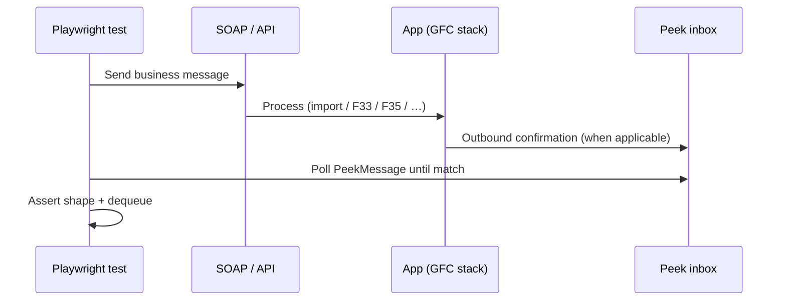
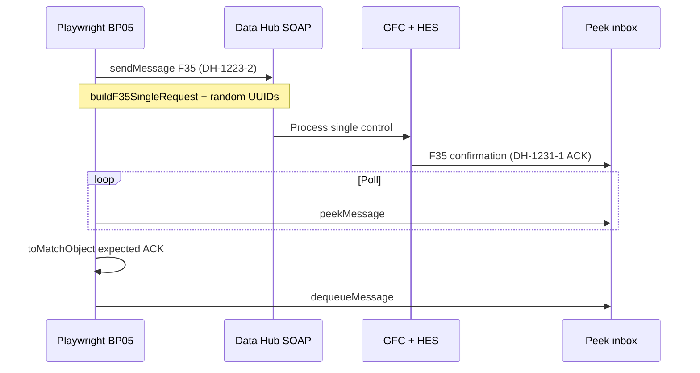

# Playwright e2e for GFC business processes

**Parent:** Flexibility Hub Connector  
**Audience:** Team KT — learn Playwright using our real suites  
**Worked example:** BP05 — Ad hoc / single control (`DH-1223-2` → `DH-1231-1`)

---

## 1. Why this page

We use Playwright to automate **business-process** checks (SOAP / HTTP / GraphQL), not Angular UI clicks.  
This page explains the basics, how we run tests, and walks **BP05** as the simplest F35 example.

---

## 2. What is Playwright? (basics)

- **Playwright** = test runner + assertions from Microsoft (`@playwright/test`).
- Commonly used for **browser** e2e (open page, click, assert).
- In GFC we mainly use its **API testing** side: the `request` fixture sends HTTP/SOAP and we assert responses.
- A **test** = arrange inputs → call the system → assert outcome (and optionally attach XML for debugging).

```text
  Spec file  →  Playwright runner  →  HTTP/SOAP/GraphQL  →  local stack
                      │
                      └─ expect(...) / poll until match
```

---

## 3. Mental model



**In one sentence:** the test drives the same market messages a partner would send, then checks the expected result.

---

## 4. Where it lives in the repo

```text
playwright-tests/
  playwright.config.ts          # projects + workers: 1
  api-gateway-e2e/              # CSV import via gateway
    business-cases/
    support/
  datahub-e2e/                  # Data Hub SOAP business cases
    business-cases/             # one spec per DH event
    support/
      builders/                 # SOAP XML builders
      expectations/             # assert shapes
      peek.ts, soap-client.ts, parties.ts, …
```

| Project | Folder | What it covers |
| -------- | ------ | -------------- |
| `api-gateway` | `api-gateway-e2e/business-cases` | Metering-point CSV import |
| `datahub` | `datahub-e2e/business-cases` | Data Hub SOAP BP flows |

**Important:** `workers: 1` — PeekMessage inbox is shared; do not parallelize these suites.

---

## 5. How we use it in GFC

| BP | Event | Message | Spec |
| -- | ----- | ------- | ---- |
| BP01 | DH-129-1 | E58 controllability | `dh-129-1-e58.spec.ts` |
| BP02 | DH-1111-1 | F33 authorisation | `dh-1111-1-f33.spec.ts` |
| BP03 | DH-1221-2 | F35 week calendar | `dh-1221-2-f35.spec.ts` |
| BP05 | DH-1223-2 | F35 single → DH-1231-1 ACK | `dh-1223-2-f35.spec.ts` |
| — | — | CSV import | `metering-points-import.spec.ts` |

Reference XML: repo `dh-business-process/`. Process index: `load-control-data-hub.md`.

---

## 6. Worked example — BP05 (simple)

**Business meaning:** Ad hoc / instantaneous load-control request forwarded to the DSO (`DH-1223-2` F35), then DSO confirmation back (`DH-1231-1` ACK).

**Spec:** `playwright-tests/datahub-e2e/business-cases/dh-1223-2-f35.spec.ts`

### Flow



### Steps in the spec (same order as code)

1. Pick metering point from `meteringPointFor['DH-1223-2']` (`parties.ts`).
2. Build F35 XML via `buildF35SingleRequest` (ids = `randomUUID()`).
3. `postSoap(..., 'sendMessage', ...)`.
4. `peekUntilMatchingF35Confirmation` until ACK matches `expectedF35ConfirmationDh1231_1`.
5. Attach send + peek XML to the Playwright report.

### Building blocks (reuse — do not reinvent)

| Piece | Role |
| ----- | ---- |
| `builders/f35-single-request.ts` | SOAP body for DH-1223-2 |
| `expectations/f35-confirmation-dh-1231-1.ts` | Stable ACK assert shape |
| `peek.ts` | Poll + dequeue |
| `soap-client.ts` | `postSoap` |
| `parties.ts` | GLNs / GSRNs |

---

## 7. How to run

### Prerequisites

```powershell
# From repo root — datahub profile; F35 ACK also needs HES + ActiveMQ
.\scripts\compose-up.ps1 --profile datahub --profile hes -d
```

```powershell
cd playwright-tests
npm install
# Only for suites that use import / GraphQL:
$env:GFC_OAUTH_CLIENT_SECRET="<from team secret store>"
```

BP05 itself is SOAP + peek (no OAuth), but still needs the stack above.

### Commands

```powershell
# BP05 only
npx playwright test datahub-e2e/business-cases/dh-1223-2-f35.spec.ts --project=datahub

# All datahub BP suites
npm run test:datahub

# HTML report
npm run test:report
```

More detail: `playwright-tests/README.md`.

---

## 8. Adding another business process (checklist)

1. Confirm BP ↔ DH event in `load-control-data-hub.md`.
2. Check `dh-business-process/` for reference XML.
3. Prefer **extend** existing builders / peek / expectations.
4. Add `meteringPointFor['DH-…']` if needed.
5. New spec under the correct `business-cases/` folder — mirror BP05 structure.
6. Document the run command in `playwright-tests/README.md`.

---

## 9. Links

- Repo: `playwright-tests/README.md`
- BP05 spec: `datahub-e2e/business-cases/dh-1223-2-f35.spec.ts`
- Reference XML: `dh-business-process/DH-1223-2_F35_Forwarding_load_control_single_request.xml`
- Confirmation XML: `dh-business-process/DH-1231-1_F35_Confirmation_of_load_control.xml`
- Parent Confluence: Flexibility Hub Connector
